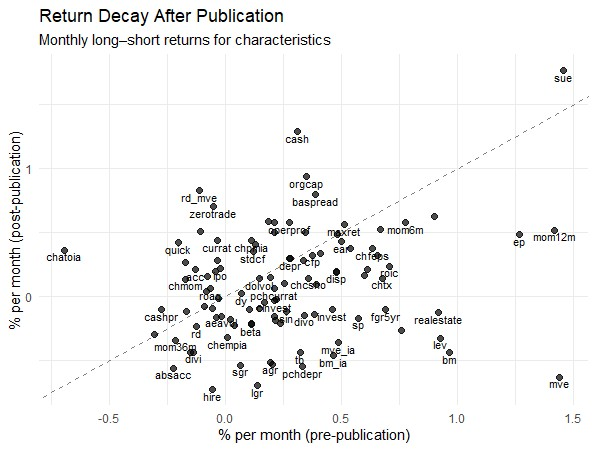
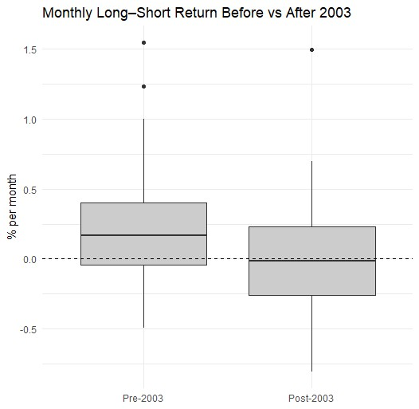
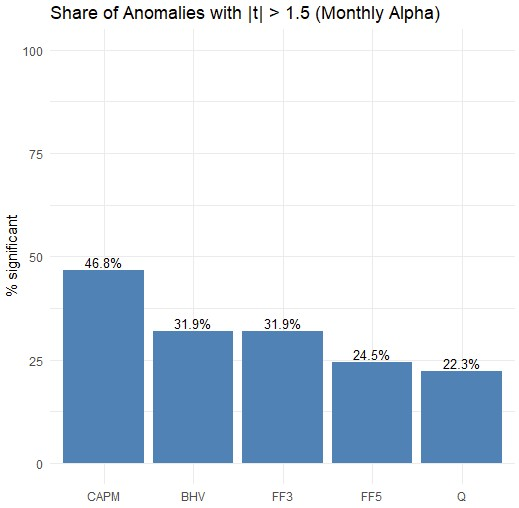

# Post-Publication Decay in Factor Return Predictability

The question was whether stock return anomalies still work once the paper documenting them is published, or whether investors trade them away. I rebuilt 94 characteristics from Green, Hand & Zhang (2017) using CRSP, Compustat and I/B/E/S data from 1960 to 2023, traded each one as a value-weighted long-short portfolio rebalanced monthly, and looked at how returns changed after the original sample period, after publication, after 2003 and after 2015.

## Results

Average long-short returns were 0.22% a month in the original sample period and 0.33% after the sample ended but before publication. After publication they fell to 0.07%.

Using the McLean & Pontiff (2016) regression, returns rise by 0.171% a month out of sample (t = 2.41) and fall by 0.154% a month after publication (t = -2.34). Splitting at 2015 gives -0.149% after 2015 (t = -1.26), so the decline seems to carry on, although that estimate isn't significant.

Better factor models explain away most of the alphas. With |t| > 1.5 as the cut-off, 46.8% of anomalies are significant under CAPM, falling to 31.9% under FF3 and the behavioural factors, 24.5% under FF5 and 22.3% under the q-factor model. Returns also drop to around zero after 2003, in line with Green, Hand & Zhang.

My conclusion was that the predictability is real but doesn't last, and with a realistic implementation the US market looks close to semi-strong efficient for published signals.



Points below the dashed line earned less after publication than before.

<p>
  
  
</p>

## Data

- CRSP daily, weekly and monthly, Compustat annual and quarterly, and I/B/E/S, all through WRDS
- January 1960 to December 2023 (767 months)
- 4,104 stocks across 12 industries
- 94 anomaly portfolios, published between 1973 and 2016, giving 66,882 anomaly-months

## Method

- To avoid look-ahead bias, annual accounting data is lagged 6 months and quarterly data 2 months. CRSP and Compustat are linked with the CCM table, and I/B/E/S through historical CUSIPs.
- Each month, stocks are sorted 30/40/30 on each characteristic, going long whichever end the original paper found earns higher returns. Portfolios are value-weighted so microcaps don't dominate, and characteristics are winsorised at 1%/99%.
- Alphas are estimated against CAPM, Fama-French 3 and 5 factor, the q-factor model and the Daniel, Hirshleifer & Sun behavioural factors.
- Decay is tested with pre/post comparisons and the McLean & Pontiff regression (characteristic fixed effects, standard errors clustered by month):

  `R_it = a_i + b1 * PostSample_it + b2 * PostPublication_it + e_it`

## Code

```
setup.R                     install packages, set up WRDS login (run once)
run_all.R                   runs everything in order
R/00_config.R               settings and connections
R/functions.R               helper functions
R/characteristic_metadata.R variable list, sort directions, publication dates
R/01_compustat.R            accounting characteristics
R/02_crsp.R                 market characteristics, betas, CCM links
R/03_ibes.R                 analyst characteristics, SUE
R/04_characteristics.R      firm-month panel
R/05_portfolio_sorts.R      long-short portfolios and alphas
R/06_publication_decay.R    decay tests and regressions
R/07_figures.R              charts
```

Running it needs a WRDS account. Run `setup.R` once, add your WRDS login to `.Renviron`, then run `run_all.R`. No WRDS data is included in the repo.

## Notes on this version

I lost the final version of the code when I reset my PC, so this is the latest copy I had saved. I've tidied it up and changed a couple of settings (winsorising and the 1.5 t-stat cut-off) to match what the dissertation describes, but I haven't been able to re-run it since I no longer have WRDS access. The results and charts above are from the dissertation itself.

Reviewing this version, I found some issues. Some of them may have been fixed in the final version, but without the final code I can’t check, so I’ve listed them here:

- The long/short direction looks the wrong way round for a few characteristics compared with the original papers: `ill`, `baspread`, `zerotrade`, `price_delay`, `aeavol`, `rd`, `chatoia`, `pchsale_pchxsga`, `herf`, and possibly `age`. This flips the sign of those portfolios' returns, which affects the regression estimates but not the |t| counts.
- The I/B/E/S summary data isn't filtered to a single forecast period (`fpi`), so `disp`, `nanalyst`, `chfeps`, `sfe` and the forecast in `sue` mix different horizons.
- Return-based characteristics like `mom1m` and `mom12m` end up lagged one month more than intended.
- `price_delay` uses the last weekly return of each month rather than a proper return series, the Compustat fallback for `sue` isn't per share, and `ipo` flags every firm's first year in the sample rather than just new listings.
- There's no limit on how long accounting data is carried forward, although the dissertation says 12 months for annual data and 3 for quarterly.
- The code builds 102 characteristics rather than the 94 in the dissertation (the extra ones are `betasq`, `dolvol`, `lgr`, `maxret`, `mom6m`, `pchquick`, `quick` and `stdacc`), and it uses the newer q5 factors rather than the original q-factor model.
- Returns are in decimals here, while the dissertation reports percentage points, and Table 1 isn't produced by this script.

Other extensions I'd look at: net-of-cost returns, timing signals to actual filing dates (Bowles et al., 2024), and international markets.

## References

- Green, Hand & Zhang (2017), The characteristics that provide independent information about average U.S. monthly stock returns, *Review of Financial Studies*
- McLean & Pontiff (2016), Does academic research destroy stock return predictability?, *Journal of Finance*
- Hou, Xue & Zhang (2015), Digesting anomalies: An investment approach, *Review of Financial Studies*
- Fama & French (2015), A five-factor asset pricing model, *Journal of Financial Economics*
- Daniel, Hirshleifer & Sun (2020), Short- and long-horizon behavioral factors, *Review of Financial Studies*
- Scheuch, Voigt & Weiss (2023), *Tidy Finance with R*
